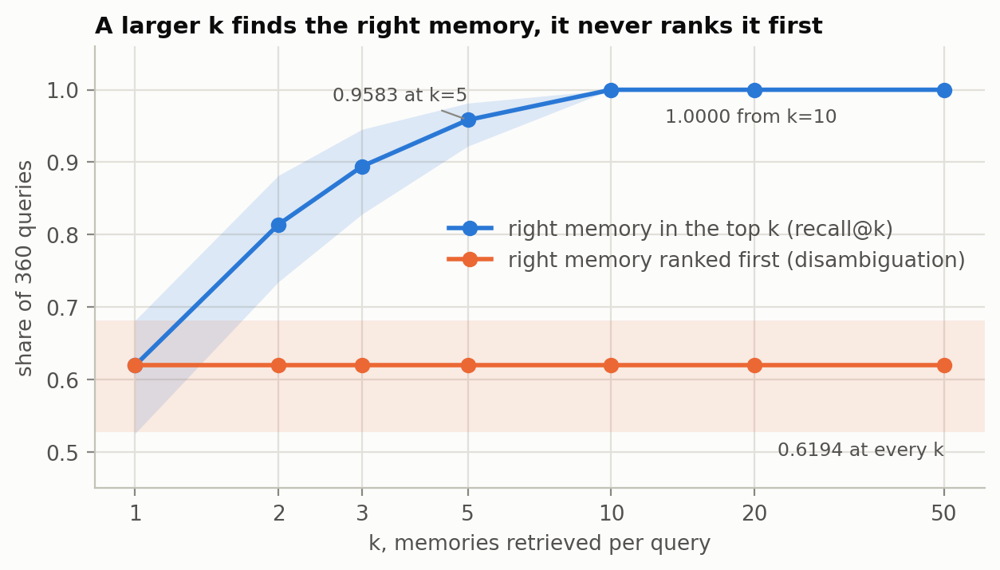
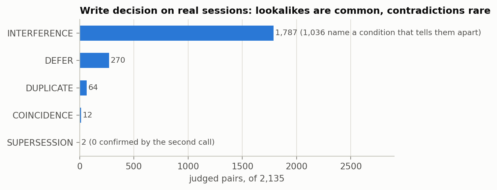
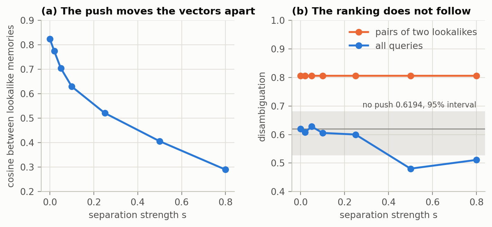
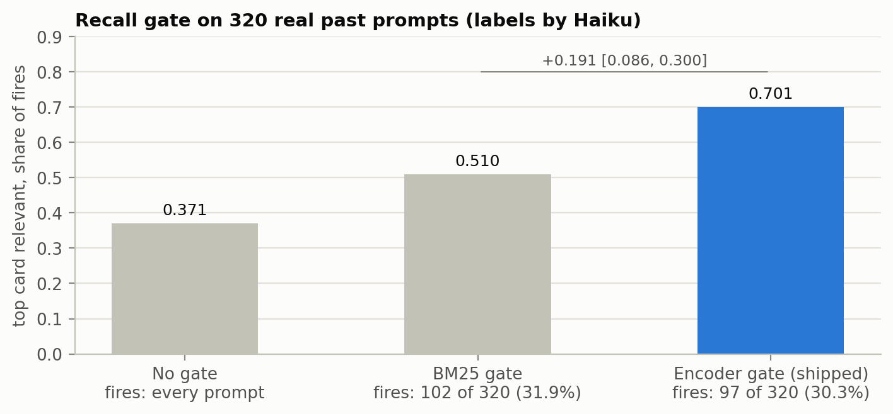
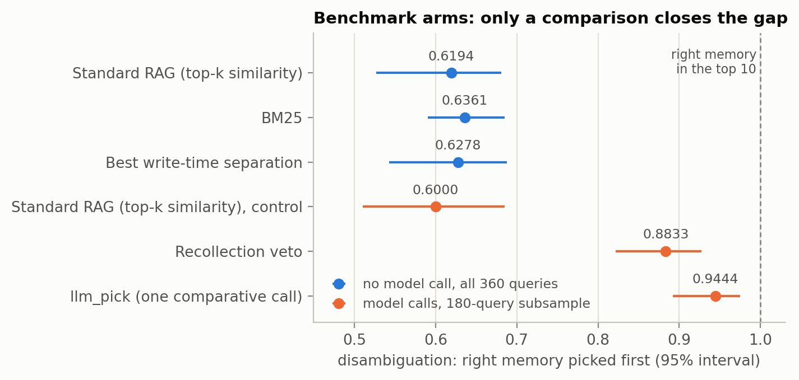

# lesson-recall: long-term memory for Claude Code

A Claude Code plugin that learns from your past sessions. When you correct the
agent, it writes the lesson down as a small card. When a later prompt needs that
lesson, the card comes back. When nothing fits, it stays silent.

A different approach to RAG: instead of trusting top-k similarity, it decides
at write time which memories compete, and stays silent unless one clearly fits.

## The problem

Coding agents forget everything between sessions. You explain that the tests
need a flag, that a helper already exists, that a deploy goes to staging first,
and next week you explain it again.

The usual fix is retrieval: store everything, embed the prompt, fetch the k most
similar memories. In my measurements that part already works. On a synthetic
benchmark the right memory is in the top 10 every time, but it is picked first
only 0.6194 of the time, and a larger k does not change that. The right memory
is retrieved and then out-ranked by its lookalikes, or it was never written
down. **The work is in the write path**, not in the retriever.

## The idea

Decide at write time what a memory is and which memories it competes with.
At read time, stay silent unless a card clearly fits, and let the model that is
already reading the prompt do the picking.

```
session transcript
  -> cut into units          (every stretch is read; corrections only decide the cuts)
  -> one Haiku call per unit (0 to 2 lesson cards, each tied to a verbatim quote)
  -> write decision          (new card against its nearest cards: duplicate,
                              supersedes, coincides, or interferes and gets linked)
  -> append-only event log   (nothing is merged or deleted; every decision can be undone)

your prompt
  -> BM25 shortlist of 3     (trigger and referent count twice, lesson once)
  -> local encoder gate      (cosine against a threshold fitted on your own past prompts)
  -> 0 to 3 cards injected   (as observations that may not apply)
```

**The lesson card.** A referent (what it is about), a lesson (one or two
sentences, hedges kept), a trigger (the kind of request that should recall it),
a scope (this project, or everywhere), and evidence (session id, byte offset, a
verbatim quote). A card whose quote cannot be found in the session is dropped.

**The write side runs in the background.** A hook on Stop, PreCompact and
SessionEnd hands the session to a detached pass that reads only what was added
since its last visit. No prompt ever waits for it.

**The read side makes no model call.** A hook on every prompt ranks the cards
with BM25 over the cards in scope, and a local encoder (bge-small-en-v1.5 through
ONNX) gates the top 3 by cosine. Both thresholds are quantiles of your own
replayed prompts, refitted as the store grows.

**Cards can follow you across devices.** Optionally, each device pushes its own
append-only log to a private GitHub repository of yours and reads the others.
Two devices never write the same file, so a sync can lose a race but never conflict.

## How it works, and why

The brain is the design motivation here, not a claim that this plugin
implements the brain. Where a block borrows only a name, it says so.
Synthetic means the MemBrain benchmark corpus (120 episodes, 360 queries, 33
clusters of lookalike memories, MiniLM encoder, 5 seeds). Real means the author's own Claude Code sessions. Every number is copied from the research record;
[`docs/figures/data.json`](./docs/figures/data.json) lists the source of each
plotted value.

### Standard RAG: a sum over the top k

Retrieval-augmented generation (RAG) in its original form
([Lewis et al., NeurIPS 2020](https://arxiv.org/abs/2005.11401), Section 2)
answers a question $`x`$ by retrieving passages $`z`$ and marginalising over
the top k of them. The RAG-Sequence model is

```math
p_{\mathrm{RAG}\text{-}\mathrm{Sequence}}(y \mid x) \;\approx\; \sum_{z \,\in\, \operatorname{top}_k\left(p(\cdot \mid x)\right)} p_\eta(z \mid x) \prod_{i=1}^{N} p_\theta\left(y_i \mid x, z, y_{1:i-1}\right)
```

with a dense retriever (DPR, a two-encoder search):

```math
p_\eta(z \mid x) \;\propto\; \exp\!\left(d(z)^\top q(x)\right), \qquad d(z) = \mathrm{BERT}_d(z), \qquad q(x) = \mathrm{BERT}_q(x)
```

- $`x`$ is the input (for us, the prompt) and $`y = (y_1, \dots, y_N)`$ the generated answer.
- $`z`$ is one stored passage (for us, one memory).
- $`p_\eta(z \mid x)`$ is the retriever: how similar the passage looks to the input.
- $`d(z)`$ and $`q(x)`$ are the passage and query embeddings; their dot product is the similarity.
- $`\operatorname{top}_k`$ keeps the k passages with the highest $`p_\eta`$ and drops the rest.
- $`p_\theta(y_i \mid x, z, y_{1:i-1})`$ is the generator: the next token given the input, one passage and the tokens so far.

In words: store everything, fetch the k most similar, and let each one vote
with a weight equal to its similarity.

### The problem sits in top-k

The sum treats the k passages as interchangeable support. Nothing in it asks
whether two passages are about the same thing; their only relation is the
retriever weight. For a memory store that is the wrong assumption, because
memories come in lookalike families: the same deploy script with two
different flags, the same test suite before and after a change.

Take the right memory $`z^\ast`$ and a lookalike $`z'`$. Their relative weight is

```math
\frac{p_\eta(z^\ast \mid x)}{p_\eta(z' \mid x)} \;=\; \exp\!\left(\big(d(z^\ast) - d(z')\big)^\top q(x)\right)
```

When the two embeddings are nearly equal the ratio is close to 1, and the
answer is driven by whichever lookalike happens to score higher. The ratio does
not contain $`k`$. Raising k adds passages with lower scores, which are more
lookalikes, but it never changes how $`z^\ast`$ stands against $`z'`$. So two
quantities hide in the formula, and only one of them depends on k:

```math
R@k = P\left(z^\ast \in \operatorname{top}_k\right), \qquad A = P\left(z^\ast = \arg\max_z \, p_\eta(z \mid x)\right)
```

$`R@k`$ (recall) asks whether the right memory was fetched. $`A`$
(disambiguation) asks whether it wins against its lookalikes. On the synthetic
corpus with plain vector search, $`R@5 = 0.9583`$ and $`R@k = 1.0000`$ from
$`k = 10`$ on, while $`A = 0.6194`$ at every k from 1 to 50 (BM25: 0.6361 at
every k). Every query that fails at k = 1 fails at every larger k.

<picture>
  <source media="(prefers-color-scheme: dark)" srcset="docs/figures/png/recall-vs-k-dark.png">
  
</picture>

*Synthetic benchmark, 360 queries: a larger k finds the right memory every
time from k = 10 and never ranks it first more often. Shaded: 95% intervals.*

The loss is competition between similar memories, not retrieval. A better
retriever or a larger k cannot fix it, so the fix belongs in the write path:
decide what a memory is, and which memories it competes with, before anything
is retrieved. So we looked at how human memory handles this. One block per
idea: the brain mechanism, the math we took from it, what the plugin does, and
its number.

### 1. Store lessons, not transcripts

**Brain.** The brain keeps what an episode taught, the gist, not a recording of it.

**Math.** A background pass cuts each session into units and one Haiku call
per unit proposes at most 2 cards, each a referent (what it is about), a lesson
(hedges kept) and a trigger (the request that should recall it). Gists invent:
the research measured a 5.02% invented-belief rate in stored assertions. So every
card carries a quote and is kept only if the quote is found verbatim in one of
the unit's turns, after lowercasing and collapsing whitespace:

```math
\mathrm{keep}(c) = \mathbf{1}\Big[\, |\mathrm{norm}(\mathrm{quote}_c)| \ge 12 \;\land\; \exists\, t \in \mathrm{unit}(c) : \mathrm{norm}(\mathrm{quote}_c) \subseteq \mathrm{norm}(t) \,\Big]
```

**Number.** On real sessions 8 of 478 proposed cards failed this check (1.7%).

**An idea that did not hold: surprise as a filter.** The plan was to read only
surprising stretches (a user correction, an interrupt, a burst of tool errors).
On real sessions, flagged episodes held a lesson in 149 of 281 (53.0%) and calm
spans in 32 of 60 (53.3%). Reading only the flagged ones would have dropped
about half the lessons. Surprise now decides where to cut; every stretch is
read.

### 2. Separate lookalikes at write time, with a decision

**Brain.** The dentate gyrus gives two similar inputs codes that sit further
apart than the inputs did (pattern separation).

**Math.** The plugin separates with a decision instead of geometry. A new card
$`c`$ meets its neighbours: the up to 5 active cards with the highest BM25
score against it that share at least 3 distinct terms with it. For each pair
Haiku answers two bits, same referent $`\rho`$ and same value $`\nu`$, and the
pair of bits picks the class:

| $`\rho`$ same referent | $`\nu`$ same value | Class | What happens |
|---|---|---|---|
| yes | yes | DUPLICATE | no new card; the old one's count goes up and gains the evidence |
| yes | no | SUPERSESSION | the older card is retired, after a second call confirms it (block 3) |
| no | yes | COINCIDENCE | both kept, no link |
| no | no | INTERFERENCE | both kept, linked when the judge names the condition that tells them apart |
| either unsure | | DEFER | the new card is added, nothing else changes |

At recall an interfering card shows its closest linked neighbour as "not to be
confused with ...; condition". Nothing is merged or deleted: the store is an
append-only event log.

**Number.** On 2,135 real judged pairs: 1,787 INTERFERENCE (1,036 with a named
condition), 270 DEFER, 64 DUPLICATE, 12 COINCIDENCE, 2 SUPERSESSION. The classes are the Haiku judge's labels.

<picture>
  <source media="(prefers-color-scheme: dark)" srcset="docs/figures/png/write-decision-dark.png">
  
</picture>

*Real sessions, 2,135 judged pairs: most neighbours are lookalikes that must
both stay, contradictions are rare.*

**2b. Moving the vectors apart: tried, failed, closed inside its premises.**
The literal version of pattern separation moves stored vectors apart at write
time. We pushed each colliding pair apart symmetrically on frozen MiniLM
vectors. Theorem 1 of the MemBrain paper says why that cannot work for a pair.
Push stored vectors $`v_i, v_j`$ along half their difference
$`u = (v_i - v_j)/2`$ with strength $`s`$ and one shared normaliser $`Z`$:

```math
v_i' = \frac{v_i + s\,u}{Z}, \qquad v_j' = \frac{v_j - s\,u}{Z} \quad\Longrightarrow\quad q^\top v_i' - q^\top v_j' = \frac{1+s}{Z}\left(q^\top v_i - q^\top v_j\right)
```

Proof sketch: subtract the two lines, $`q^\top(v_i' - v_j') = \big(q^\top(v_i - v_j) + 2s\,q^\top u\big)/Z`$,
and $`2u = v_i - v_j`$ turns the bracket into $`(1+s)\,q^\top(v_i - v_j)`$.
Since $`(1+s)/Z > 0`$, the push widens the margin for every query $`q`$ and
never changes which of the two wins. The data agreed: on pairs of two
lookalikes, disambiguation stayed at 0.8056 at all seven strengths. The
transform did fire (sibling cosine fell from 0.824 to 0.290), and 0 of 14
configurations cleared the bar; the best gained +0.83 points against a 5-point
bar (synthetic). The result is proven closed only inside its premises:
symmetric push, shared normaliser, same dimension, two competitors. The
brain's version is directional: it moves the new memory away from its stored
neighbours. That asymmetric variant sits outside the theorem and was never
properly tested (one attempt fell from 0.806 to 0.694 on pairs). It is not in
this plugin.

<picture>
  <source media="(prefers-color-scheme: dark)" srcset="docs/figures/png/separation-dark.png">
  
</picture>

*Synthetic benchmark: the push separates the vectors (a) and leaves the
ranking where it was (b); pair accuracy is flat at 0.8056, Theorem 1 seen in
data. Strength was selected on the same corpus, which favours the mechanism.*

### 3. Update instead of piling up

**Brain.** In reconsolidation a recalled memory that meets a mismatch is
updated, not duplicated.

**Math.** Supersession is the one class that hides a card from recall, so it
alone needs two agreeing judgments. With the older card $`o`$ and the newer
card $`n`$ ordered by timestamp:

```math
\mathrm{retire}(o) = \mathbf{1}\big[\, \mathrm{class}(o, n) = \mathrm{SUPERSESSION} \;\land\; \mathrm{confirm}(o, n) = \mathrm{yes} \,\big]
```

where $`\mathrm{confirm}`$ is a second Haiku call that answers whether the
newer card makes every part of the older one obsolete, and defaults to no. An
unconfirmed supersession becomes DEFER. A retired card is marked superseded,
never deleted, and `restore` undoes it. A DUPLICATE raises the old card's count,
shown as "seen 3x"; the count does not change ranking.

**Number.** On real sessions both proposed supersessions failed the confirming
call: zero cards retired.

### 4. Recall by cue and by place

**Brain.** A memory comes back when the cue matches how it was stored
(encoding specificity) and more easily in the same context.

**Math.** Text becomes terms by casefolding, taking runs of Unicode word
characters (character pairs in scripts written without spaces), dropping stop
words and one-letter terms, and trimming a few English suffixes. The stop words
are learned from your own prompts by `cli.py tune`: every term found in at least
10% of them. Before that, a built-in English and Dutch list applies. The trigger and referent are the retrieval key, so a card's term
counts are $`f(t, c) = 2 f_{\mathrm{key}}(t, c) + f_{\mathrm{lesson}}(t, c)`$.
Each distinct prompt term counts once in the BM25 score:

```math
\mathrm{BM25}(q, c) = \sum_{t \,\in\, T(q)} \mathrm{IDF}(t)\,\frac{f(t,c)\,(k_1 + 1)}{f(t,c) + k_1\left(1 - b + b\,\dfrac{|c|}{\overline{|c|}}\right)}, \qquad \mathrm{IDF}(t) = \ln\!\left(1 + \frac{n - n_t + 0.5}{n_t + 0.5}\right)
```

with $`k_1 = 1.2`$, $`b = 0.75`$, $`T(q)`$ the set of prompt terms,
$`|c|`$ the card's term count, $`\overline{|c|}`$ the mean over the pool,
$`n`$ the pool size and $`n_t`$ the number of cards containing $`t`$. Only
cards in scope enter the pool: general cards everywhere, project cards inside
their project on any device (and in a parent folder at least two levels below
home):

```math
\mathrm{pool}(q) = \{\, c : \mathrm{scope}(c) = \mathrm{general} \;\lor\; \mathrm{project}(c) \subseteq \mathrm{cwd}(q) \,\}
```

The encoder sees the whole card as `referent. trigger lesson`.

### 5. Stay silent by default

**Brain.** The analogy is loose: involuntary recall happens when a cue matches
strongly, and most moments bring nothing back. The math is a plain threshold.

**Math.** BM25 shortlists the top 3 in-scope cards. The encoder
$`e`$ (bge-small-en-v1.5, a local model, CLS vector normalised to unit length)
runs only when the best BM25 score $`S_1(q)`$ clears $`\theta_{\mathrm{pre}}`$
with at least 2 matched terms $`m_1(q)`$. Card $`c_i`$ of the shortlist is shown
when its cosine clears $`\theta`$, best cosine first, and the prompt fires when
at least one card is shown:

```math
\mathrm{show}(c_i) = \mathbf{1}\big[\, S_1(q) \ge \theta_{\mathrm{pre}} \;\land\; m_1(q) \ge 2 \;\land\; e(q)^\top e(c_i) \ge \theta \,\big]
```

Both thresholds are fitted, not chosen. The plugin replays the user's own
$`N`$ past prompts, each with the cards from its own session held out.
$`\theta_{\mathrm{pre}}`$ is the BM25 score that lets a share 0.70 of them
through. With $`M_j`$ the best shortlist cosine of replayed prompt $`j`$
(prompts that fail the pre-gate never fire),

```math
\theta = \max\Big\{\, t : \#\{\, j \le N : \mathrm{pre}(q_j) \land M_j \ge t \,\} \ge \lfloor \rho N \rfloor + 1 \,\Big\}, \qquad \rho = 0.33
```

that is, the quantile of replayed scores at $`1 - \rho`$: about a third of past
prompts would fire. A fixed threshold drifts as the store grows (10.5 fired on
37.5% of prompts at 172 cards and on 55.3% at 413), so both thresholds refit
once the pool has grown by a factor 1.15. Without the encoder, the gate is the
same rule on the BM25 score alone.

**Number.** On 320 real past prompts labelled by Haiku, the top card is
relevant in 0.701 of fires (30.3% fire) against 0.510 for a BM25-only gate
(31.9% fire), and 0.371 with no gate. Paired bootstrap 95% interval of the
difference: +0.191 [0.086, 0.300]. Over 906 labelled card pairs the cosine separates
relevant from irrelevant cards with an AUC of 0.793, against 0.676 for the
BM25 score. The encoder and card text were chosen among 18 variants on the
same 320 prompts (the weakest scored 0.608).

<picture>
  <source media="(prefers-color-scheme: dark)" srcset="docs/figures/png/gate-dark.png">
  
</picture>

*Real sessions, 320 past prompts, labels by Haiku: at nearly the same firing
rate the encoder gate shows a relevant top card 7 times in 10, the BM25 gate 5.
Gate chosen among 18 variants on these prompts.*

### 6. Let a comparison choose

**Brain.** In recall-to-reject, a similar but wrong candidate cues the stored
trace of the true item, and the mismatch licenses rejecting the lure.

**Math.** Two read-time pickers replace the argmax over similarity. The
recollection veto checks each candidate against the stored trace with one call
per candidate. llm_pick makes one call that sees the prompt and all k
candidates together:

```math
\mathrm{pick} = \mathrm{LLM}\big(q, \operatorname{top}_k\big) \qquad \text{versus} \qquad \mathrm{pick} = \arg\max_{z \in \operatorname{top}_k} p_\eta(z \mid q)
```

Progress is measured as the share of the available headroom closed,
$`H = (A - A_{\mathrm{ctrl}}) / (R - A_{\mathrm{ctrl}})`$, against the
saturated recall $`R = 1.0000`$.

**Number.** The least exciting idea worked best. llm_pick reached 0.9444
[0.8918, 0.9752] against 0.6000 for the similarity control on the same
180-query subsample, closing 86.1% of the headroom. The brain-inspired veto
lost to it: 0.8833, paired difference -6.11 points [-9.89, -3.08]
(lost a comparison, not proven closed; it ran at k = 5 only, where its own
precondition does not hold). llm_pick was measured at k = 5 only and costs
about 0.014 USD per query as its own call.

<picture>
  <source media="(prefers-color-scheme: dark)" srcset="docs/figures/png/pickers-dark.png">
  
</picture>

*Synthetic benchmark: every picker without a model call sits near 0.62 (all
360 queries); one comparative call reaches 0.9444. The model-call arms ran on a
180-query subsample, whose control is 0.6000.*

**What the plugin does with this.** It makes no extra call. The cards go to the
session model, which is already reading the prompt, marked as observations that
may not apply, and that model picks or ignores them. The 0.9444 above was measured with a dedicated call at k = 5.

### Side by side

| | Standard RAG | lesson-recall |
|---|---|---|
| What is stored | every passage | lesson cards with a verbatim quote |
| When lookalikes are handled | never; they compete inside the top-k sum | at write time: duplicate, supersedes, coincides, or interferes and gets linked |
| Read rule | marginalise over the top k, weighted by similarity | shortlist by similarity, gate on a fitted threshold |
| Nothing fits | the top k are used anyway | silence |
| Who picks | the similarity weight $`p_\eta`$ | the model that reads the prompt |

RAG marginalises over the top k at read time. This plugin decides at write
time what a memory is and which memories it competes with, then allows silence,
and lets the reading model choose.

## Install

```
/plugin marketplace add tr4m0ryp/lesson-recall
/plugin install lesson-recall@lesson-recall
/lesson-recall:setup
```

The third command has Claude Code walk you through [SETUP.md](./SETUP.md): adapt
the keyword index to your language, plan the backfill and confirm its Haiku calls
with you, fill the store from past sessions, install the encoder, show you real cards, switch recall on, and
optionally set up the private backup. Needs python3 3.10 or newer and the
`claude` CLI, on Linux or macOS. 

**The plugin is on as soon as it is installed.** From then on it reads new turns
of your live sessions in the background, with Haiku calls that run through your
own Claude login and count against your plan's usage, and it injects cards that
clear the gate. Past sessions are only covered once setup has run the backfill,
which asks you first. Switch it off at any time with
`python3 <plugin root>/recall/cli.py mode off`.

## How well it works

All numbers below come from the author's own Claude Code sessions, unless they
are marked synthetic.

### The write side

```
13,922 session files scanned
    53 qualify (31 live, 22 from an archive)
   756 units read (282 surprise episodes, 474 calm chunks)
   380 held no lesson
   478 cards proposed, 8 dropped because the quote was not found verbatim (1.7%)
    57 absorbed as duplicates
   413 cards stored
```

Extraction cost 1.6905 USD for the 756 units and the write decisions 0.7992 USD,
as reported by `claude -p`. The write decision judged 2,135 pairs: 1,787
INTERFERENCE (1,036 with a named distinguishing condition), 270 DEFER, 64
DUPLICATE, 12 COINCIDENCE, 2 SUPERSESSION. Both supersessions failed the second
confirming call. Zero cards are retired.

### The read side

On 320 sampled past prompts, labelled by Haiku:

| Gate | Fires | Top card relevant | At least one shown card relevant | Shown cards relevant |
|---|---|---|---|---|
| None | every prompt | 0.371 | | |
| BM25 score | 102 of 320 (31.9%) | 0.510 | 0.627 | 0.488 of 207 |
| BM25 shortlist, encoder cosine (shipped) | 97 of 320 (30.3%) | 0.701 | 0.722 | 0.688 of 160 |

The encoder gate shows 110 relevant cards against 101, with 47 fewer cards in
total. Top-card precision rises by +0.191, paired bootstrap 95% interval
[0.086, 0.300]. Over 906 labelled pairs, the cosine separates relevant from
irrelevant cards with an AUC of 0.793, against 0.676 for the BM25 score.

**Latency.** The read hook took 82 ms at 172 cards, with 31 to 52 ms of scoring
at 413 cards. When the encoder runs it costs 615 ms inside the hook and 0.75 s
wall; when the BM25 pre-gate stops the prompt first, 27.5 ms and 0.09 s. The
pre-gate lets 70% of prompts through. The write hook returns after 77 ms.

### How these numbers were measured

- **Sessions:** the author's own Claude Code sessions, from the funnel above.
- **Labels:** by Haiku, one call per prompt.
- **Gate choice:** the encoder and its card text were chosen among 18 variants on
  the same 320 prompts; the lowest variant measured 0.608.
- **Encoder:** English (bge-small-en-v1.5). For prompts mostly in other
  languages, setup uses the keyword gate.

## What leaves your machine

- **Transcript excerpts go to Haiku** through your own Claude login, after
  credential-shaped text is redacted. These calls use your plan's usage.
- **The encoder is downloaded once** from PyPI and Hugging Face, checked against
  pinned sha256 digests.
- **Cards go to your own private repository**, and only if you turn on sync.
- **Nothing goes to the plugin author.**

The store lives in `~/.local/share/claude-recall` (or `$RECALL_HOME`). Switch
with `python3 <plugin root>/recall/cli.py mode on|shadow|off`; undo steps are
at the end of [SETUP.md](./SETUP.md).

## License

lesson-recall is **source-available**, licensed under the [PolyForm Noncommercial License 1.0.0](./LICENSE), **not** an OSI open-source license.

- **You may** use, modify, fork, and share lesson-recall freely for any **noncommercial** purpose, as long as you keep the copyright and `Required Notice:` lines (see [`NOTICE`](./NOTICE)) and credit *"lesson-recall by Keygraph, Inc."*
- **You may not** sell it, bundle it into a paid product, or run it as a paid/hosted service **without a commercial license**.

Copyright (c) 2026 Keygraph, Inc. Commercial licensing enquiries: see [`NOTICE`](./NOTICE).
